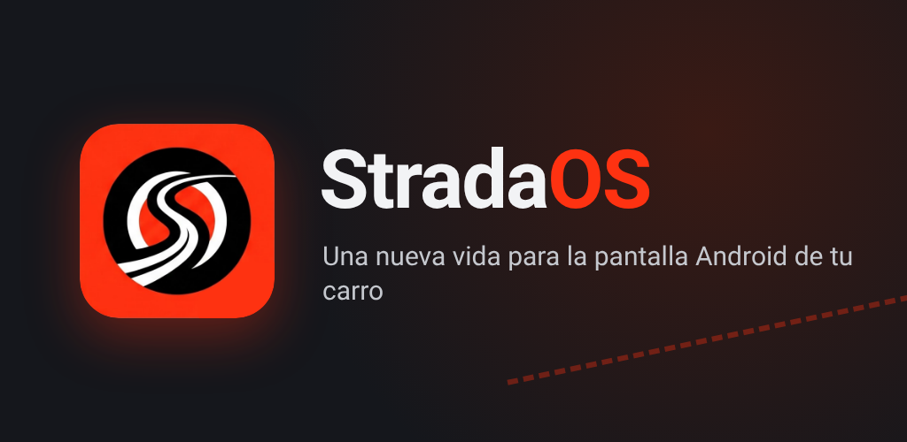
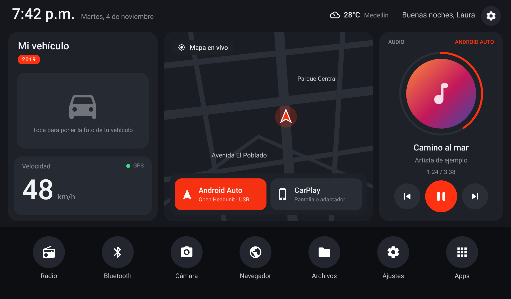
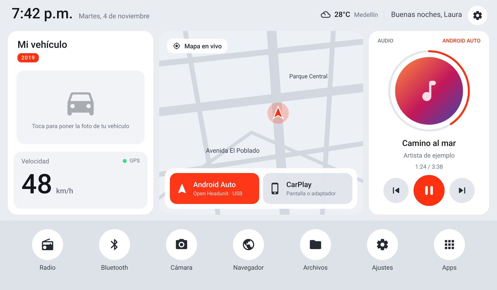

<h1>FordLauncher</h1>
<b>Auto Head Unit UI · Una nueva vida para la pantalla Android de tu carro</b>
  

  
<b>🌐 <a href="https://lordnordic-debug.github.io/FordLauncher/">lordnordic-debug.github.io/FordLauncher</a></b>
  
<h4>Descargar</h4>

 
IzzyOnDroid y F-Droid: próximamente

---

**FordLauncher** es un launcher (pantalla de inicio) gratuito y de código abierto para las pantallas Android de los carros. Reemplaza el menú genérico de fábrica por una interfaz moderna **sin flashear nada ni tocar el sistema**: se instala como una app más y, si no te gusta, la desinstalas y la pantalla queda como estaba.

Nació para revivir las radios chinas que dicen *«Android 6 o superior»* pero por dentro corren **Android 4.x**, donde la Play Store ya no funciona y casi ninguna app se instala. También funciona en pantallas modernas.

## ✨ Funciones

- 🚗 **Tu vehículo:** nombre, etiqueta y foto. Al subir la foto, FordLauncher **le quita el fondo** y la ajusta al recuadro (con vista previa y 4 niveles, incluido quitar el reflejo del piso).
- 🗺️ **Mapa en vivo** de tu ciudad con tu posición y rumbo (OpenStreetMap). Se guarda en el equipo para verlo sin señal por donde ya pasaste.
- 📲 **Android Auto y CarPlay**, cada uno con su botón:
  - Si tu pantalla trae Android Auto/CarPlay (ZLink, CarLink, TLink, AutoKit…), los abre directamente.
  - Si no, Android Auto funciona con [Open Headunit](https://github.com/andreknieriem/headunit-revived) por cable USB.
  - Tú eliges cómo conectar el celular, y FordLauncher lo respeta.
- 🎵 **Reproductor** con carátula, título, artista, tiempo y progreso de lo que suene por **Bluetooth** o **Android Auto**, con controles.
- 🌤️ **Clima** de tu ciudad (°C / °F).
- ⏱️ **Velocímetro** por GPS, reloj y saludo personalizado.
- 🧭 **Accesos** a Radio, Bluetooth, Cámara, Navegador y Archivos de fábrica. La **cámara de reversa sigue funcionando**.
- 🎨 **Modo oscuro, claro o automático** y 10 colores de acento.
- ⚙️ **Ajustes** ordenados por categorías y asistente inicial.
- 🔔 **Avisos de actualización** desde GitHub, con código QR para descargar desde el celular.

## 📸 Capturas

## 📥 Instalación

1. Descarga **`FordLauncher-x.y.z.apk`** desde [Releases](https://github.com/lordnordic-debug/FordLauncher/releases/latest).
2. Cópialo a una memoria USB y, en la pantalla, **pásalo a la memoria interna** con el explorador de archivos. En muchas radios el instalador no puede leer directamente la USB.
3. En la pantalla activa **Ajustes → Seguridad → Orígenes desconocidos**.
4. Toca el APK e instálalo.
5. Presiona **Inicio** y elige **FordLauncher → Siempre**.
6. Sigue el asistente: tu nombre, tu vehículo, el color y la foto.

### Android Auto en pantallas sin Android Auto
1. Instala [Open Headunit](https://github.com/andreknieriem/headunit-revived/releases) con los mismos pasos.
2. En Open Headunit activa **«Pista actual de AA en la sesión multimedia»**, para que FordLauncher muestre la canción.
3. En FordLauncher, **Ajustes → Música → Carátula de Android Auto**, para que también muestre la carátula.
4. Conecta el celular por cable USB y toca **Android Auto**.

## 📋 Compatibilidad

| | Mínimo | Probado |
|---|---|---|
| Android | 4.1 (API 16) | 4.2 (API 17), pantalla con chip Autochips AC8227 |
| Pantalla | Cualquier resolución horizontal | 1024×600 |

¿La probaste en otra pantalla? Cuéntalo en un [issue](https://github.com/lordnordic-debug/FordLauncher/issues) para sumarla a la tabla.

## ❓ Preguntas frecuentes

<b>Mi pantalla dice Android 6, ¿por qué no instalan las apps?</b>

Muchas pantallas muestran un número de versión falso. Mira el Android real en <b>FordLauncher → Ajustes → Acerca de</b> (el número de API). La API 17 equivale a Android 4.2.

<b>¿FordLauncher hace que vuelva a funcionar la Play Store?</b>

No. Google dejó de dar soporte a esas versiones de Android. Con Android Auto, las apps (Maps, Waze, Spotify, WhatsApp) corren en tu celular y se ven en la pantalla.

<b>El celular dice «Ninguna aplic. funciona con este accesorio USB»</b>

Lo causa la app de espejo de fábrica (EasyConnection/CarbitLink), que toma el USB antes que Open Headunit. Ve a Ajustes → Aplicaciones → EasyConnection → <b>Borrar datos</b>, apaga y enciende el carro, y elige Open Headunit → Usar siempre. También está explicado en <b>FordLauncher → Ajustes → Conexión</b>.

<b>La música Bluetooth no suena hasta que abro la app de Bluetooth</b>

Desde la versión 2.9 FordLauncher lo resuelve: en pantallas Clinkway/Autochips cambia el audio a Bluetooth solo cuando el celular empieza a sonar (<b>Ajustes → Música → Audio Bluetooth</b>). En otras marcas activa en ese mismo lugar <b>«Abrir la app de música Bluetooth al conectar el celular»</b>. Si no te funciona, exporta el diagnóstico con el celular sonando (<b>Sistema → Exportar diagnóstico</b>) y compártelo en un issue.

<b>¿Puedo tener CarPlay sin adaptador?</b>

No. Apple exige un chip de autenticación dentro del equipo, así que no se puede activar solo con software. Si tu pantalla trae CarPlay, o usas un adaptador CarPlay USB para pantallas Android, el botón CarPlay abre su app.

<b>El mapa no carga</b>

Necesita internet (por ejemplo, el punto de acceso del celular). En Android 4.x algunos servidores de mapas rechazan la conexión segura, y FordLauncher prueba varios automáticamente. Deja presionado el mapa para ver el diagnóstico.

<b>Android Auto va lento</b>

Es el procesador de la pantalla. En Open Headunit baja la resolución a 480p, a 30 FPS y con códec H.264.

## 🔒 Privacidad

FordLauncher no tiene cuentas, anuncios ni analíticas. Tu ubicación se usa solo en el equipo para el mapa, el velocímetro y el clima. Lee los detalles en [PRIVACY.md](PRIVACY.md).

## 🤝 Contribuir

Los reportes, ideas y pull requests son bienvenidos. Lee [CONTRIBUTING.md](CONTRIBUTING.md). La regla de oro es que **todo debe seguir funcionando en Android 4.1**.

## ☕ Apoya el proyecto

FordLauncher es y seguirá siendo **gratis**. Si revivió tu pantalla, puedes apoyar su desarrollo:

- ⭐ **Dale una estrella** a este repositorio. Es gratis y ayuda a que más gente lo encuentre.
- ☕ **Ko-fi:** invítame un café en **[ko-fi.com/fordlauncher](https://ko-fi.com/fordlauncher)** (tarjeta o PayPal, sin crear cuenta).
- 💖 **GitHub Sponsors:** *próximamente* (en revisión por GitHub).

## 📈 Historial de estrellas

## 👥 Colaboradores

## ⚖️ Aviso legal

- FordLauncher es un proyecto independiente, **gratuito y sin fines de lucro**. No está afiliado a Google, Apple ni a ningún fabricante de vehículos o de pantallas.
- *Android Auto* es marca de Google LLC y *CarPlay* es marca de Apple Inc. Los nombres de vehículos se usan solo como referencia de compatibilidad.
- FordLauncher no modifica el sistema de la pantalla. Úsalo bajo tu responsabilidad y **no lo manipules mientras conduces**.

## 📄 Licencia y créditos

FordLauncher se publica bajo la [GNU GPL v3.0](LICENSE). Usa o se apoya en:
- [Open Headunit](https://github.com/andreknieriem/headunit-revived) (GPL-3.0), app aparte para Android Auto.
- Mapas © [colaboradores de OpenStreetMap](https://www.openstreetmap.org/copyright), OpenTopoMap y Esri.
- Clima: [Open-Meteo](https://open-meteo.com) (CC BY 4.0).
- [QR Code generator](https://github.com/nayuki/QR-Code-generator) de Project Nayuki (MIT).
- Íconos [Material Symbols](https://fonts.google.com/icons) (Apache 2.0) y certificados raíz de Mozilla (MPL-2.0).

---

🇬🇧 English

**FordLauncher** is a free, open-source launcher for Android car head units. It replaces the generic factory menu with a modern home screen without flashing or modifying the system. It was built for Chinese units that claim "Android 6+" but really run Android 4.x, and it also works on modern units.

Features include a vehicle card with automatic background removal, a live map, Android Auto and CarPlay buttons (they open your unit's projection app, or [Open Headunit](https://github.com/andreknieriem/headunit-revived)), a media card with album art for Bluetooth and Android Auto, weather, a GPS speedometer, dark/light themes and update notices. Minimum Android 4.1. The interface is in Spanish. License: GPL-3.0.

